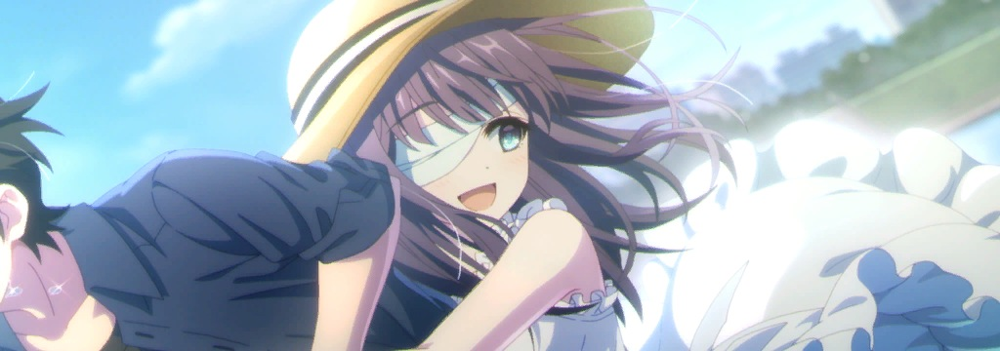

<p align="center">
  
</p>

# Misora: Unity3D Revision Tool & Story Editor

<p align="center">
  <a href="https://www.python.org/downloads/"></a>
  <a href="LICENSE"></a>
  <a href="https://github.com/K0lb3/UnityPy"></a>
</p>

> *"A dedicated, zero-pipeline revision editor and search tool for Princess Connect! Re:Dive Unity3D story assets and XUAT translation dictionaries."*

---


## 📖 Overview

In *Princess Connect! Re:Dive*, story data is distributed in compiled Unity3D asset bundles (`.unity3d`). When proofreading or correcting translations after assets have already been packed into `BepInEx\Translation\en\RedirectedResources\story\...`, making revisions traditionally required a tedious, multi-step pipeline:

1. Extract the `.unity3d` binary asset.
2. Locate the specific script file and dialogue segment.
3. Edit the text while carefully managing engine command tags.
4. Repack the asset using separate command-line utilities.

**Misora** completely eliminates this pipeline. It loads `.unity3d` bundles directly into memory, exposes dialogue in a clean **Game Display View** side-by-side with a **Raw AST Script View**, and allows you to patch the bundle in-place in under **100 milliseconds** (`Ctrl+S`).

---

## ✨ Key Features

### 1. Zero-Pipeline In-Place Repacking
*  **Instant Patching**: Open any `.unity3d` story asset directly. Edit the dialogue text or speaker name and hit **Ctrl+S**; Misora repacks the bundle in-memory with byte-exact binary serialization (`>H` command IDs, base64 bit-inverted payloads). No intermediate files or extraction needed.
*  **Bi-directional XUAT Sync**: When saving a bundle correction, Misora can automatically locate and update the matching community translation dictionary (`.txt`) under `Translation\en\Text\`, creating automated `.bak` backups.

### 2. Dual-View Story Editor
*  **Game Display View (Clean Dialogue)**: Displays the dialogue exactly as the player sees it in-game, uninterrupted by technical script cues for lip-sync (`lip_sync`), animations (`chara_anim`), camera pans, or voice cues (`voice`).
*  **Raw AST Script View (Technical Records)**: Displays the full sequence of underlying engine command records with line markers and decoded arguments.
*  **Placeholder Insertion**: Insert `{playername}` with a single click or shortcut (**Ctrl+P**). Misora automatically maps `{playername}` $\leftrightarrow$ `{0}` between community dictionaries and the game engine.

### 3. Notepad++ Style Multi-File Search
*  **Multi-Scope**: Search within the active file, a target folder, or across the whole project (`RedirectedResources` + `Text`).
*  **Regex & Case-Sensitivity**: Full regular expression and case-sensitive matching support.
*  **XUnity Auto Translator (XUAT) Matching**:
  * Respects `IgnoreWhitespaceInDialogue`: Matches text across lines regardless of newlines (`\n`), spaces, or Japanese full-width spaces (`\u3000`).
  * Seamlessly matches `{playername}` in translations against `{0}` in raw game assets.
*  **Interactive Results Tree**: Grouped by file with dialogue box indices and speaker tags; click any search result to immediately jump to and edit that dialogue box.

### 4. Standalone & Extensible
*  **Self-Contained**: Stored in its own dedicated standalone repository, completely independent and ready to deploy.
*  **Misora Character Aesthetic**: Styled with a dark palette (`#1e1e24`) and Misora's signature bubblegum pink accents (`#ff7da7`).

---

## ⌨️ Keyboard Shortcuts

| Shortcut | Action | Description |
| :--- | :--- | :--- |
| **Ctrl + O** | Open File | Open a `.unity3d` bundle or `.txt` story script |
| **Ctrl + Shift + O** | Open Folder | Select a folder scope for multi-file search |
| **Ctrl + S** | Save & Patch | Byte-exact repack into `.unity3d` and sync to XUAT `.txt` |
| **Ctrl + F** | Find | Jump focus to the Notepad++ search query box |
| **Ctrl + P** | Insert Placeholder | Inserts `{playername}` at current cursor position |
| **Alt + Left** | Previous Box | Navigate to previous dialogue box |
| **Alt + Right** | Next Box | Navigate to next dialogue box |
| **F5** | Reload File | Revert changes and reload active document from disk |
| **Return (in Find)** | Search | Execute search across selected scope |

---

## 🚀 Quickstart

### Prerequisites
* **Python 3.11+** installed (Python 3.12 recommended).
* **Dependencies**: Install required packages:
  ```bash
  pip install -r requirements.txt
  ```

### Launching Misora
Double-click `misora.bat` in Windows Explorer, or run:
```bash
py -3.12 misora.py
```

You can also pass a file or folder path directly on the command line, or drag and drop a `.unity3d` file directly onto `misora.bat`:
```bash
misora.bat "C:\Gacha\PriconneRe-TL\src\BepInEx\Translation\en\RedirectedResources\story\data\9080155.unity3d"
```

---

## 📁 Project Structure

```
Misora-Editor/
├── assets/
│   ├── banner.jpg              # Readme header banner
│   ├── misora_chibi.png        # Chibi mascot artwork
│   ├── icons/                  # Caravan buff bullet icons
│   ├── Splash_1.jpg            # Application splash art 1
│   ├── Splash_2.jpg            # Application splash art 2
│   ├── Splash_3.jpg            # Application splash art 3
│   ├── icon.py                 # Character theme palette & UI styling
│   └── splash.py               # Non-blocking splash boot window
├── core/
│   ├── __init__.py             # Package exports
│   ├── bundle_io.py            # In-memory UnityPy bundle loader & repacker
│   ├── logger.py               # Category-filtered UI logger
│   ├── mtl_engine.py           # Machine translation & AI prompt integrations
│   ├── search_engine.py        # Notepad++ multi-scope search engine with XUAT normalization
│   ├── story_ast.py            # AST parser, Box model & byte-exact codec
│   ├── undo_journal.py         # Multi-level transactional undo/redo journal
│   └── xunity_sync.py          # Bi-directional sync for XUAT translation dictionaries
├── tests/
│   ├── __init__.py
│   ├── test_misora_core.py     # Core engine and codec unit tests
│   └── test_misora_ui_integration.py # UI integration & folder DnD tests
├── .gitignore
├── LICENSE                     # MIT License
├── misora.bat                  # Windows launcher with Python auto-detect
├── misora.py                   # Main Tkinter dual-view story editor GUI
├── PROJECT_STATE.md            # Comprehensive project state, bug audit & roadmap
├── README.md                   # Standalone project documentation
├── register_association.bat    # Register .unity3d file association
├── requirements.txt            # Python dependencies (UnityPy>=1.20.0, Pillow>=10.0.0)
└── unregister_association.bat  # Remove .unity3d file association
```

---

## 🧪 Running Unit Tests

Run the test suite:
```bash
py -3.12 -m unittest discover -s tests
```

---

## 📄 License

This project is licensed under the MIT License. Princess Connect! Re:Dive and its character assets are trademarks and copyright of Cygames, Inc.
